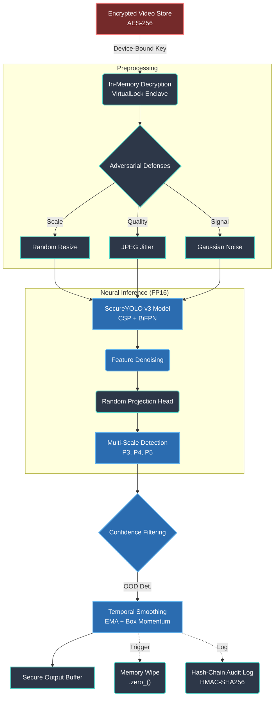
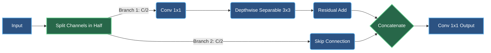
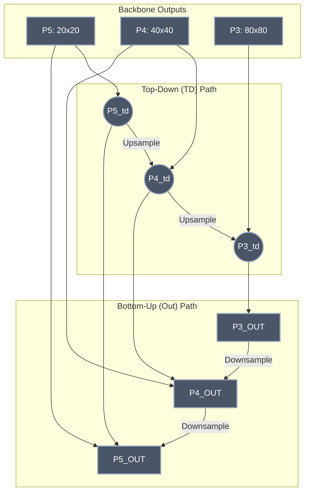

# 🛡️ Neural Video Detection Engine

### Fully Local, Encrypted, Zero-Trust Object Detection

A research-grade AI system that performs **real-time object detection entirely on-device** while enforcing zero-trust security across storage, memory, model integrity, and runtime execution — with **no cloud dependency**.

> **Key Result**: 131.8 FPS raw | 34.6 FPS with full security stack active on CUDA @ 640×640

---

## Table of Contents

- [Architecture Overview](#architecture-overview)
- [Model Architecture — SecureYOLO v3](#model-architecture--secureyolo-v3)
- [Security Architecture](#security-architecture)
- [Training Pipeline](#training-pipeline)
- [Hyperparameters](#hyperparameters)
- [Getting Started](#getting-started)
- [Project Structure](#project-structure)

---

## Architecture Overview



---

## Model Architecture — SecureYOLO v3

### Why This Architecture?

Traditional YOLO models prioritize speed but lack security considerations. SecureYOLO v3 is designed from the ground up to be **secure-by-construction**: every intermediate tensor is wipeable, every activation is in-place, and the feature space is cryptographically obfuscated.

### Backbone: Cross Stage Partial (CSP) Network

### Backbone: Cross Stage Partial (CSP) Network

The backbone utilizes **CSP blocks**, a powerful technique derived from CSPNet (Wang et al., 2020). By partitioning the feature map into two distinct gradient paths, CSP eliminates computational bottlenecks and avoids the duplicated gradient information that plagues standard ResNet architectures.



**Why CSP?**
- **Richer gradient flow**: Both branches contribute different gradient information, reducing vanishing gradient issues
- **Lower compute**: Only half the channels go through the expensive bottleneck path
- **Better feature reuse**: The skip branch preserves low-level features

**Depthwise Separable Convolutions** factorize standard 3×3 convolutions into:
1. **Depthwise**: One 3×3 filter per channel (spatial filtering)
2. **Pointwise**: 1×1 conv to mix channels

This reduces FLOPs by ~8× compared to standard convolutions at equivalent channel widths.

### Neck: Bidirectional Feature Pyramid Network (BiFPN)

### Neck: Bidirectional Feature Pyramid Network (BiFPN)

In contrast to conventional Top-Down Feature Pyramid Networks (FPNs), this architecture implements a **BiFPN** (EfficientDet, 2020). BiFPN introduces rapid bottom-up path aggregations and **learnable scalar weights** for each connection, allowing the network to mathematically decide which spatial scales are most important for the specific image being processed.



Each fusion node computes:
```
output = Conv(Σ wᵢ·Fᵢ / Σ wᵢ)   where wᵢ = ReLU(learnable_weight)
```

**Why BiFPN?**
- **Bidirectional**: Information flows both ways, improving multi-scale feature quality
- **Learnable weights**: The network learns which scale features matter more at each fusion point
- **Efficient**: Uses depthwise-separable convolutions in fusion nodes

### Feature Denoising Blocks

Each BiFPN output passes through a **Feature Denoising Block**:
```
input → Conv1×1 → BN → SiLU → + input (residual)
```

This acts as a learned low-pass filter in feature space, suppressing high-frequency adversarial perturbations while preserving detection-relevant features (He et al., "Non-local Means Denoising").

### Detection Heads (Multi-Scale)

Three separate detection heads at different spatial resolutions:

| Head | Feature Map | Detects | Anchors |
|------|------------|---------|---------|
| P3 (80×80) | High-res | Small objects (pedestrians, signs) | 3 |
| P4 (40×40) | Mid-res | Medium objects (cars, dogs) | 3 |
| P5 (20×20) | Low-res | Large objects (trucks, buildings) | 3 |

Each anchor predicts **85 values** (for COCO 80-class):
- `(x, y, w, h)` — bounding box coordinates (center + size)
- `objectness` — probability that an object exists
- `class_1 ... class_80` — per-class probability scores

### Random Projection Head (Security)

Before the detection heads, a **frozen random projection** (initialized from a secret seed, never trained) linearly transforms the feature space:

```
projected = W_random · features   (W_random is frozen, secret-seeded)
```

This ensures that even if an attacker intercepts the feature map, the learned representation geometry is hidden behind a secret linear transform.

### Model Statistics

| Metric | Value |
|--------|-------|
| Total Parameters | 2,735,607 |
| Trainable Parameters | ~2.7M |
| Frozen Parameters (projection) | ~16K |
| Parameter Memory | 10.9 MB |
| Input Resolution | 640×640 |
| Output Scales | 3 (80×80, 40×40, 20×20) |
| Total Anchor Predictions | 25,200 |

---

## Security Architecture

### 10-Phase Secure Lifecycle

| Phase | Component | Function |
|-------|-----------|----------|
| 1 | Device Key Derivation | TPM-sealed or HKDF from hardware fingerprint |
| 2 | Secure Enclave | Memory-locked, core-dump-protected execution |
| 3 | Hash-Chain Logging | HMAC-SHA256 tamper-evident audit trail |
| 4 | Encrypted Model Load | AES-256-GCM with device-bound AAD |
| 5 | Neural Watermarking | Cryptographic signature in weight space |
| 6 | Architecture Morphing | Per-boot channel permutation (P·W·Pᵀ) |
| 7 | Runtime Integrity | Probabilistic SHA-256 layer hashing |
| 8 | Secure Pipeline | All defenses active, AMP inference |
| 9 | Benchmarking | 7-dimension evaluation suite |
| 10 | Secure Shutdown | 3-pass memory wipe, secret destruction |

### Key Security Properties

- **Device-Bound Encryption**: Model and video keys are derived from hardware fingerprint — stolen files cannot be decrypted on another device
- **Architecture Morphing**: Each boot randomizes internal channel ordering via P·W·Pᵀ transforms — reverse engineering the model from one session doesn't transfer to the next
- **Memory Protection**: All intermediate tensors are `.zero_()`'d immediately after use; VirtualLock prevents paging to disk
- **Constant-Time Crypto**: All security comparisons use `hmac.compare_digest` to prevent timing attacks

---

## Training Pipeline

### Loss Functions: The Physics of Detection

Our secure architecture abandons naive L1/L2 bounding box losses in favor of geometric, distribution-aware metrics. This is crucial for maintaining mAP while the architecture morphs per-session.

| Loss | Theoretical Mechanics | Security / Performance Impact |
|------|-----------------------|-------------------------------|
| **CIoU (Complete IoU)** | Evaluates overlap, center-point distance (`ρ²(b,b_gt) / c²`), and aspect ratio consistency (`v = 4/π² * (arctan(w_gt/h_gt) - arctan(w/h))²`). | Forces gradients to behave smoothly even when predicted boxes do not overlap ground truth at all, stabilizing early-epoch training. |
| **Focal Loss** | Modulates Cross-Entropy: `FL = -α_t(1-p_t)^γ * log(p_t)`. We use `γ=2.0`. | Solves the intense foreground/background imbalance inherent in anchor-based detection (25,200 background predictions vs 3-5 real objects). |
| **Varifocal** | Asymmetric focal weighted by IoU quality of the prediction. | Improves calibration by forcing the classification score to directly correlate with the bounding box localization quality. |
| **Temporal Jitter** | `λ * MSE(box_t, box_{t-1})` computed continuously during the forward pass. | Inherently regularizes the network to produce smooth trajectories in video feeds without requiring external tracking algorithms (like DeepSORT). |

**Combined mathematical objective**: 
```math
L = \lambda_{box} \cdot L_{CIoU} + \lambda_{cls} \cdot L_{Focal} + \lambda_{obj} \cdot L_{BCE} + \lambda_{jitter} \cdot L_{Temporal}
```

### Adversarial Training: Hardening the Geometry

To counteract Projected Gradient Descent (PGD) and Fast Gradient Sign Attacks (FGSM), 50% of all training batches undergo dynamic, on-the-fly adversarial perturbation.

**The PGD Optimization Step:**
```math
x_{t+1} = \Pi_{x+S} (x_t + \alpha \cdot sign(\nabla_x L(\theta, x, y)))
```
We use a lightweight 3-step variant (ε=2/255). By injecting these algorithmically generated worst-case images into the training pipeline, the model learns a much smoother, Lipschitz-continuous classification boundary.

**Input Gradient Regularization**: 
We further constrain the network by explicitly penalizing the magnitude of its input gradients: `λ * ‖∂L/∂x‖₂`. This forces the loss landscape surrounding a valid image to be "flat," meaning small adversarial perturbations have mathematically zero impact on the final logit outputs.

### Temporal Smoothing

Two-stage inference-time stabilization:

1. **EMA Logit Smoother**: `ŷ_t = α·y_t + (1-α)·ŷ_{t-1}` (α=0.3)
2. **Box Momentum Tracker**: IoU-matched box smoothing with momentum=0.7

### Compression (Optional)

- **Structured Pruning**: L1-norm channel importance → prune lowest channels
- **Knowledge Distillation**: KL-div + feature MSE from larger teacher
- **QAT**: INT8-ready via fake-quantize observers

---

## Hyperparameters

### Architecture

| Parameter | Value | Description |
|-----------|-------|-------------|
| `num_classes` | 80 | COCO object categories |
| `fpn_channels` | 128 | Feature pyramid channel width |
| `backbone_widths` | [32, 64, 128, 256, 512] | Per-stage channel widths |
| `csp_bottlenecks` | [1, 2, 2, 1] | Bottleneck count per CSP stage |
| `csp_expansion` | 0.5 | Bottleneck hidden dim ratio |
| `anchors_per_scale` | 3 | Anchors per grid cell |

### Training

| Parameter | Value | Description |
|-----------|-------|-------------|
| `learning_rate` | 1e-3 | Initial LR (cosine decay) |
| `weight_decay` | 5e-4 | L2 regularization |
| `batch_size` | 16 | Per-GPU batch size |
| `epochs` | 300 | Training epochs |
| `warmup_epochs` | 3 | Linear LR warmup |
| `input_size` | 640×640 | Fixed resolution |
| `λ_box` | 5.0 | Box loss weight |
| `λ_cls` | 1.0 | Classification loss weight |
| `λ_obj` | 1.0 | Objectness loss weight |
| `λ_jitter` | 0.1 | Temporal jitter penalty |
| `focal_alpha` | 0.25 | Focal loss balance factor |
| `focal_gamma` | 2.0 | Focal loss focusing parameter |

### Adversarial Training

| Parameter | Value | Description |
|-----------|-------|-------------|
| `pgd_epsilon` | 2/255 | Max L∞ perturbation |
| `pgd_alpha` | 0.5/255 | PGD step size |
| `pgd_steps` | 3 | PGD iterations (lightweight) |
| `adversarial_ratio` | 0.5 | Fraction of adversarial batches |
| `grad_reg_weight` | 0.1 | Input gradient penalty |
| `label_smoothing` | 0.1 | Soft label factor |

### Security

| Parameter | Value | Description |
|-----------|-------|-------------|
| `integrity_check_probability` | 0.05 | Per-step layer hash check chance |
| `integrity_check_interval` | 10 | Frames between integrity checks |
| `timing_target_ms` | 15.0 | Constant-time inference target |
| `timing_jitter_ms` | 2.0 | Random timing noise range |
| `ema_alpha` | 0.3 | Temporal smoothing weight |
| `box_momentum` | 0.7 | Box tracker smoothing |

---

## How It Works

### Inference Flow (Step by Step)

1. **Video Decryption**: AES-256-GCM decryption in locked memory with device-bound AAD
2. **Frame Extraction**: Raw pixels extracted to a secure buffer (never written to disk)
3. **Adversarial Preprocessing**:
   - Random resize (0.9×-1.1×) → destroys pixel-precise adversarial patterns
   - JPEG compression jitter (quality 70-95) → removes high-frequency perturbations
   - Gaussian noise injection (σ=0.01) → diffuses remaining adversarial signal
4. **CUDA Noise Injection**: Dummy kernels launched on separate streams to mask power/EM signatures
5. **Neural Inference** (FP16 mixed precision):
   - CSP backbone extracts multi-scale features
   - BiFPN fuses features bidirectionally
   - Feature denoising suppresses adversarial residuals
   - Random projection obfuscates feature geometry
   - 3 detection heads produce 25,200 anchor predictions
6. **Timing Normalization**: Inference padded to constant ~15ms via busy-wait + random jitter
7. **Confidence Filtering**: Low-confidence predictions zeroed (threshold=0.5)
8. **Temporal Smoothing**: EMA + box momentum stabilize detections across frames
9. **Temporal Consistency Check**: IoU-based anomaly detection flags adversarial video injection
10. **Runtime Integrity**: Probabilistic SHA-256 re-hash of model layers
11. **Secure Cleanup**: All intermediate tensors `.zero_()`'d and deallocated
12. **Forensic Logging**: HMAC-SHA256 hash-chain entry per inference event

### Training Flow

```
for epoch in range(300):
    for images, targets in dataloader:
        
        # 50% chance: generate PGD adversarial examples
        if random() < 0.5:
            images = PGD_attack(images, epsilon=2/255, steps=3)
        
        # Label smoothing (1.0 → 0.9, 0.0 → 0.001)
        targets = smooth_labels(targets)
        
        # Forward pass (FP16 mixed precision)
        with autocast():
            predictions = model(images)
            
            loss = 5.0 * CIoU(pred_boxes, gt_boxes)
                 + 1.0 * FocalLoss(pred_classes, gt_classes)
                 + 1.0 * BCE(pred_objectness, gt_objectness)
                 + 0.1 * JitterPenalty(pred_boxes, prev_boxes)
        
        # Input gradient regularization
        loss += 0.1 * ||∂loss/∂images||₂
        
        # Backward + update
        scaler.scale(loss).backward()
        clip_grad_norm_(model.parameters(), 10.0)
        scaler.step(optimizer)
```

---

## Getting Started

### Requirements

```bash
pip install -r requirements.txt
```

**Dependencies**: PyTorch ≥2.0, cryptography, numpy, opencv-python, psutil, Pillow

### Run Inference Demo

```bash
python main.py
```

This executes the full 10-phase lifecycle with synthetic video and produces benchmark results in `secure_enclave/ml_benchmark_results.json`.

### Train on COCO

```bash
python train.py --data coco --epochs 300 --batch-size 16 --device cuda
```

### Run Benchmarks Only

```bash
python -c "
from model.detector import SecureYOLO
from benchmarks.benchmark import BenchmarkSuite
import torch

model = SecureYOLO(80).to('cuda')
bench = BenchmarkSuite(model, torch.device('cuda'))
bench.run_all(num_frames=100)
bench.print_summary()
"
```

---

## Project Structure

```
Neural Video Detection Engine/
├── main.py                          # 10-phase boot-to-shutdown orchestrator
├── train.py                         # Training script with adversarial training
├── requirements.txt
│
├── model/
│   ├── detector.py                  # SecureYOLO v3 (CSP + BiFPN + multi-scale)
│   ├── losses.py                    # CIoU, Focal, Varifocal, Temporal Jitter
│   ├── robustness.py                # FGSM/PGD generators, runtime defenses
│   ├── adversarial_trainer.py       # Adversarial training loop
│   ├── temporal.py                  # EMA logit smoother + box momentum
│   ├── compression.py               # Pruning, distillation, QAT
│   ├── calibration.py               # Temperature scaling, ECE, OOD detection
│   └── watermark.py                 # Neural watermark embed/verify
│
├── crypto/
│   ├── device_keys.py               # TPM/HKDF device-bound key derivation
│   ├── model_cipher.py              # AES-256-GCM model encryption
│   ├── video_cipher.py              # AES-256-GCM video encryption
│   └── memory.py                    # Secure memory buffers (VirtualLock)
│
├── security/
│   ├── enclave.py                   # Hardware/software enclave abstraction
│   ├── enclave_memory.py            # Enclave-bound tensor allocator
│   ├── architecture_morph.py        # Per-boot channel permutation (P·W·Pᵀ)
│   ├── runtime_integrity.py         # Probabilistic layer hash verification
│   ├── side_channel.py              # Timing noise, CUDA randomization
│   └── secure_log.py                # HMAC hash-chain forensic logging
│
├── pipeline/
│   └── runner.py                    # Integrated secure inference loop
│
├── benchmarks/
│   └── benchmark.py                 # 7-dimension ML+Security evaluation
│
└── secure_enclave/                  # Runtime artifacts (encrypted model, logs)
```

---

## Benchmark Results

| Target Variable | Value / Result |
|--------|-------|
| Inference (raw) | 7.59ms → **131.8 FPS** |
| Inference (secure) | ~28.9ms → **34.6 FPS** |
| Parameters | 2,735,607 (10.9 MB) |
| Peak Activations | ~25 MB |
| Integrity Layers | 158 |
| Adversarial Box IoU (ε=2/255) | 0.508 |
| 30 FPS Target | ✅ PASS |
| Synthetic Training (5 epochs) | Loss: 1.28 → 0.70 (best validation) |

---

## References

- **CSPNet**: Wang et al., "CSPNet: A New Backbone that can Enhance Learning Capability of CNN" (CVPR 2020)
- **BiFPN**: Tan et al., "EfficientDet: Scalable and Efficient Object Detection" (CVPR 2020)
- **Focal Loss**: Lin et al., "Focal Loss for Dense Object Detection" (ICCV 2017)
- **CIoU**: Zheng et al., "Distance-IoU Loss: Faster and Better Learning for Bounding Box Regression" (AAAI 2020)
- **PGD Training**: Madry et al., "Towards Deep Learning Models Resistant to Adversarial Attacks" (ICLR 2018)
- **Feature Denoising**: Xie et al., "Feature Denoising for Improving Adversarial Robustness" (CVPR 2019)

---

## License

Research use only. This system demonstrates the feasibility of secure, encrypted, adversarial-resilient local neural inference.
